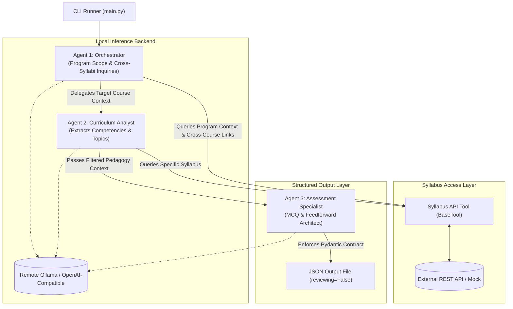

# Academic Assessment Generator (CrewAI + Local LLM)

## Overview
A modular, containerized multi-agent system using **CrewAI** in Python to generate academic assessments based on syllabus context retrieved via REST API calls. Inference is powered by a local or self-hosted LLM (Ollama or OpenAI-compatible endpoint).

The output is a structured JSON document containing multiple-choice questions (MCQs), correct answers, pedagogical feedback, forward-looking feedforward links, and review status tracking (`reviewing: false`).

---

## Architecture



### The 3 Agents
1. **Orchestrator Agent:**
   - Possesses broad visibility across all syllabi within an academic program.
   - Clarifies inter-syllabus relationships, prerequisites, and overarching program context.
   - Coordinates and passes filtered curriculum context to specialized agents.
2. **Curriculum Analyst Agent:**
   - Focuses on the specific syllabus for the target topic.
   - Analyzes learning outcomes, competencies, Bloom taxonomy targets, and concept boundaries.
3. **Assessment Specialist Agent:**
   - Constructs Multiple Choice Questions (MCQs) with options `[A, B, C, D]`.
   - Formulates detailed explanatory **feedback** (why an answer is correct).
   - Formulates actionable **feedforward** (forward-looking study paths, related concepts).
   - Enforces strict Pydantic JSON structure with `"reviewing": false` by default.

---

## Output Data Contract

```json
{
  "topic": "Relational Database Normalization",
  "program_context": "Computer Science - Database Systems",
  "reviewing": false,
  "questions": [
    {
      "id": "Q1",
      "question_text": "Which normal form requires that all non-key attributes be fully functionally dependent on the primary key, eliminating partial dependency?",
      "options": [
        "A) First Normal Form (1NF)",
        "B) Second Normal Form (2NF)",
        "C) Third Normal Form (3NF)",
        "D) Boyce-Codd Normal Form (BCNF)"
      ],
      "correct_answer": "B) Second Normal Form (2NF)",
      "feedback": "2NF specifically addresses partial dependencies, requiring tables to already satisfy 1NF and ensure all non-prime attributes depend entirely on the whole candidate key.",
      "feedforward": "Before proceeding to Third Normal Form (transitive dependencies), ensure you can confidently identify composite candidate keys and partial dependencies in Topic 4.2."
    }
  ]
}
```

---

## Project Structure

```
.
├── .env.example              # Environment variables template
├── Dockerfile                # Container build definition
├── docker-compose.yml        # Orchestration with mounted volumes
├── requirements.txt          # Python dependencies
├── PLAN.md                   # System specifications and implementation roadmap
├── README.md                 # Setup, configuration, and execution instructions
├── output/                   # Directory mounted into container for generated JSON
├── src/
│   ├── __init__.py
│   ├── config.py             # Pydantic Settings reading .env
│   ├── models/
│   │   ├── __init__.py
│   │   └── schema.py         # Pydantic schemas (QuestionItem, AssessmentOutput)
│   ├── tools/
│   │   ├── __init__.py
│   │   └── syllabus_tool.py  # CrewAI BaseTool querying Syllabus API (with mock fallback)
│   ├── agents/
│   │   ├── __init__.py
│   │   ├── orchestrator.py   # Program scope & cross-syllabi agent
│   │   ├── analyst.py        # Specific syllabus & topic extraction agent
│   │   └── specialist.py     # Question, feedback & feedforward generator
│   ├── crew.py               # Crew assemble, tasks & execution pipeline
│   └── main.py               # CLI runner with argparse (--topic, --program, --count)
└── tests/
    ├── __init__.py
    ├── test_schema.py        # Unit tests validating Pydantic models
    └── test_tool.py          # Unit tests verifying API / mock syllabus fetching
```

---

## Configuration (`.env`)

```env
# Local LLM Service (Ollama / OpenAI-Compatible)
LLM_BASE_URL=http://host.docker.internal:11434/v1
LLM_MODEL_NAME=ollama/llama3
OPENAI_API_KEY=NA

# Syllabus API
SYLLABUS_API_BASE_URL=https://api.youruniversity.edu/v1
SYLLABUS_API_TOKEN=your_bearer_token
MOCK_SYLLABUS=true

# Execution Settings
OUTPUT_DIR=/app/output
```

---

## Quickstart

### 1. Configure Environment
```bash
cp .env.example .env
# Edit .env with your Ollama host and model name
```

### 2. Run with Docker
```bash
docker compose run --rm assessment-crew --topic "Normalization and SQL" --program "Computer Science"
```
